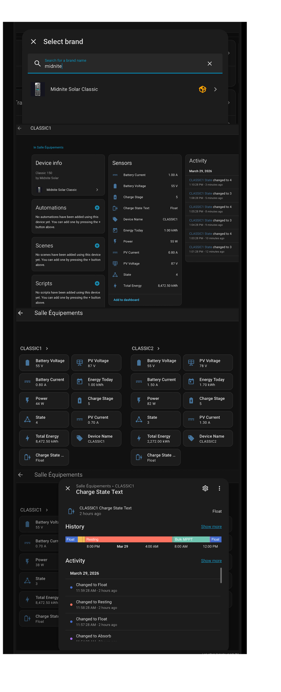

# Midnite Solar Classic — Home Assistant Integration

---

## Custom integration for **Midnite Solar Classic 150** solar charge controllers (and compatible models). Communicates with the device over **Modbus TCP**


## Features

- Periodic polling of all Classic registers via Modbus TCP
- Configurable polling interval from **10 to 3,600 seconds**
- Select which parameters to expose as HA entities via the UI
- Connection validation and automatic device name retrieval during setup
- Multi-device support (multiple Classic controllers with different IP addresses)
- Options flow (⚙️ icon) to change interval and parameter without reconfiguring
- Ability to change eleven register values allowing remote control of the Classic from HA
- **AUX 1 generator control** — SOC thresholds, start/stop delays, and Off/Auto/On mode
- **25 binary sensors** exposing every documented bit of the `InfoFlagsBits` status word
- A button is made available to write register changes to EEPROM.
- A switch to turn the Classic ON or OFF
- **Connection diagnostics** — automatic retries on brief network interruptions, and a
  downloadable health report

## Scope — AUX 1 is assumed to drive a generator

This integration is built around a specific use case: **AUX 1 configured as a
state-of-charge trigger for a two-wire generator start input**, which means
`Aux1Function` set to 22 (SOC% HIGH) or 23 (SOC% LOW).

The AUX 1 registers are polymorphic — the Classic reuses the same register
addresses for different purposes depending on `Aux1Function`. Registers 4166 and
4172 hold a *percentage* in SOC% mode, but a *voltage* in the voltage-based
functions (1–4, 7, 8, 17–20). The unit, scale and valid range all change with the
function.

**If you use AUX 1 for something else, data collection still works.** Polling,
decoding and writing are unaffected, and no entity becomes unavailable. What you
get instead is a labelling mismatch: entities named "Aux 1 Low Threshold" with a
`%` unit will report a value that actually means volts, and the 0–100 range will
reject voltage setpoints above 10.0 V.

Two ways to work around it:

- **Rename the affected entities.** Settings → Devices & Services → Entities →
  select the entity → ⚙️ → change the name. The new name lives in the entity
  registry and survives restarts and integration updates. Home Assistant will
  offer to update the entity ID as well — declining keeps long-term statistics
  intact, which is usually what you want.
- **Read the entity attributes.** Every AUX 1 and Info Flag entity carries the
  manufacturer's own register name and description as state attributes, so the
  underlying register is always identifiable regardless of the displayed name.

Making the unit adapt to `Aux1Function` automatically is possible but awkward —
Home Assistant handles a unit change on an existing entity poorly, invalidating
statistics and raising warnings. If you run AUX 1 in a voltage-based mode and
would like this supported properly, please open an issue.

## Requirements

| Component         | Description                                                                                                                                                                        |
| ----------------- | ---------------------------------------------------------------------------------------------------------------------------------------------------------------------------------- |
| Home Assistant OS | Built on version 2026.3+                                                                                                                                                           |
| pymodbus          | Built with version ≥ 3.6.0 (installed automatically in HAOS)                                                                                                                       |
| network           | The Classic must be connected to the local network and reachable from Home Assistant. → Need the address and the Classic's name must be set in the unit. See Network in user manual. |


## Installation

### 1 - Install HACS (if not allready done)

- Goto Settings → Devices & Services → Add integration
- Find HACS and follow the installation
- Login with GitHub

### 2 - Add the repository as a Custom repository

In the HACS interface:

- Click on the 3 dots on top right corner
- Select Custom repositories
- Add the repo's URL [https://github.com/qcda1/ha_midnite_classic](https://github.com/qcda1/ha_midnite_classic)
- Use Type Integration
- Click Add

### 3- Add the integration through HACS

Once the addition of the repository:

- Search for Midnite Solar Classic in HACS
- Click on "Download"
- Restart Home Assistant: Settings → System → Restart (Restart icon top right).

### 4 — Add the integration

Settings → Devices & services → **+ Add integration** → search for **Midnite Solar Classic**.

## Configuration

### Step 1 — Connection

| Field           | Description                            | Default |
| --------------- | -------------------------------------- | ------- |
| IP Address      | Classic's IP on the local network      | —       |
| Modbus TCP Port | Classic's Modbus server port           | **502** |
| Interval (s)    | Polling frequency in seconds (30–3600) | **60**  |

The integration connects immediately to validate the connection and read the device name (`Name` register).

### Step 2 — Monitored parameters

A checklist displays all parameters returned by your Classic.  
Checked by default:

`BatVoltage`, `PVVoltage`, `BatCurrent`, `EnergyToday`, `Power`, `ChargeStage`, `State`, `PVCurrent`, `TotalEnergy`, `Name`, `ChargeStateText`

## Created entities

Each selected parameter becomes a `sensor` entity with unit, device class and state class assigned automatically.

For example:

| Parameter       | Unit | Class                     |
| --------------- | ---- | ------------------------- |
| BatVoltage      | V    | voltage / measurement     |
| PVVoltage       | V    | voltage / measurement     |
| BatCurrent      | A    | current / measurement     |
| Power           | W    | power / measurement       |
| EnergyToday     | kWh  | energy / total_increasing |
| TotalEnergy     | kWh  | energy / total_increasing |
| ChargeStateText | —    | —                         |

Entity IDs are derived from the device name, not from the area the device belongs
to — so `sensor.classic1_battery_voltage` rather than
`sensor.living_room_classic1_battery_voltage`. This keeps entity IDs stable if the
device is later moved to a different area.


## Eleven configuration entities

- The integration will also create eleven configuration entities allowing user to change the Classic register values. This allow remote control of the Classic from Home Assistant.

Register numbers below are decimal.

| Parameter                     | Unit | Values                               | Register |
| ----------------------------- | ---- | ------------------------------------ | -------- |
| endingAmps                    | A    | See Classic Owner's Manual           |  4246    |
| AbsorbVoltageSetPoint (Set)   | V    | See battery specs                    |  4149    |
| FloatVoltageSetPoint (Set)    | V    | See battery specs                    |  4150    |
| EqualizeVoltageSetPoint (Set) | A    | See battery specs                    |  4151    |
| EqualizeTimeSetPoint (Set)    | s    | See battery specs max 4h (14400s)    |  4162    |
| EqualizeIntervalDay (Set)     | day  | Nb days between Equalize stages      |  4163    |
| DaysBetweenBulkAbsorb (Set)   | Days | Days between Bulk/Absorb. Skip days. |  4252    |
| Aux 1 Low Threshold (Set)     | %    | SOC below which AUX 1 asserts        |  4166    |
| Aux 1 High Threshold (Set)    | %    | SOC above which AUX 1 de-asserts     |  4172    |
| Aux 1 Delay Time (Set)        | s    | 0 – 6553.5 s, 0.1 s steps            |  4167    |
| Aux 1 Hold Time (Set)         | s    | 0 – 6553.5 s, 0.1 s steps            |  4168    |

## AUX 1 generator control

The AUX 1 relay output is typically wired to a generator's two-wire start input.
This integration exposes the registers that drive it, so generator start and stop
thresholds can be managed from Home Assistant.

See [Scope](#scope--aux-1-is-assumed-to-drive-a-generator) above for what changes
if AUX 1 is configured for something other than SOC%-based control.

### Mode select

`select.<device>_aux_1_mode` exposes the three documented modes:

| Option       | Behaviour                                                 |
| ------------ | --------------------------------------------------------- |
| Aux 1 Off    | Output forced OFF (0 V)                                   |
| Aux 1 Auto   | Output follows the function configured in `Aux1Function`  |
| Aux 1 On     | Output forced ON (~14 V)                                  |

The mode is packed into bits 6–7 of register 4165, which also holds the AUX 1 and
AUX 2 function assignments. Writes are read-modify-write, so changing the mode
leaves the other fields — including a WhizBang Jr assignment on AUX 2 — untouched.

### Relay state

`binary_sensor.<device>_aux_1_state_on` reports the live relay state, decoded from
bit 14 of `InfoFlagsBits`. Use it to trigger automations on generator start and
stop, or to accumulate generator run time with `history_stats`.

### Two corrections to the published register map

These registers were validated on physical hardware, cross-checked against the
MNGP console and timed generator cycles. Two of them do not behave as the
register map documents:

**Thresholds 4166 / 4172 are percentages, not tenths of a volt.** The manual
documents `register / 10` volts. In SOC% HIGH/LOW mode (`Aux1Function` 22 or 23)
these registers hold a state-of-charge percentage — a register reading of 94
displays as 94 on the MNGP, not 9.4.

**Delays 4167 / 4168 are tenths of a second, not milliseconds.** Timed relay
transitions confirmed this across two orders of magnitude: registers of 300, 600
and 6000 produced delays of 30 s, 60 s and 600 s.

### The delay registers act opposite to their names

`Aux1Function = 23` (SOC% LOW) is an Active Low function, so the manufacturer's
names describe the logic condition rather than the relay:

| Register | Manual name                  | Actual effect           |
| -------- | ---------------------------- | ----------------------- |
| 4167     | Delay before **Asserting**   | delays generator **stop**  |
| 4168     | Hold before **De-asserting** | delays generator **start** |

In Active High mode (function 22) the mapping is reversed. Entity names follow the
manufacturer's register names so they can be traced back to the register map.

## Info Flag binary sensors

Register 4130/4131 (`InfoFlagsBits`) is a 32-bit status word. Each documented bit
is exposed as its own `binary_sensor`, carrying the manufacturer's flag name and
description as state attributes. The raw `InfoFlagsBits` sensor is still available
for existing templates.

- **Regular entities:** Aux 1 State On, Aux 2 State On, Equalize In Progress
- **Diagnostic entities:** the remaining 22 flags
- **Fault flags** (EEPROM error, GroundFaultF, ArcFaultF, OCP, NegBatCurrentF,
  LowBatteryVF, TempCompShortedF, InputShortedF, HyperVoc) use `device_class:
  problem`, so they display as **Problem / OK**
- **Classic Over Temperature** uses `device_class: heat`

RESERVED bits are omitted.

## Button to write changes to EEPROM

- A button is created with the equipment to write modified data from RAM to EEPROM (Electrically Erasable Programmable Read-Only Memory). It mimik the "DATA SENT AND SAVED TO THE CONTROLLER" message on the MNGP when users change controller's parameters. This ensure the changes will remain in effect after a controller full shutdown or a reboot.

## Switch ON/OFF

- A switch is created to allow the user to switch the controller ON and OFF the same way he would do with the MNGP (MODE ➔ On/Off).


### Notes:

- *Equalize Time SetPoint = 0 → Manual mode. Equalize Time SetPoint ≠ 0 enables 'EQ Auto' mode*
- *Don't forget that EqualizeVoltage >= AbsorbVoltage >= FloatVoltage*
- *Refer to the Midnite Solar Classic Owner’s Manual for details about adjustments of these values.*
- ***It is important to push the "Save Settings to EEPROM" button to store the modified values in memory to the EEPROM so it keeps its on controller shsutdown or reboot.*** This applies to the AUX 1 registers as well.
- *Details on Classic's registers are documented here → [Register map](docs/classic_register_map_Rev-C5-December-8-2013.pdf)*

## Options

Click ⚙️ to change the polling interval or the monitored parameter list.  
Changes take effect immediately.

## Multiple Classic controllers

Repeat "Add integration" with a different IP address for each device.


## Troubleshooting

| Symptom              | Solution                                                                 |
| -------------------- | ------------------------------------------------------------------------ |
| "Cannot connect"     | Check IP, port, and that the Classic is powered on and reachable from HA |
| Unavailable entities | Check HA logs: Settings → System → Logs                                  |
| pymodbus error       | Restart HA — pymodbus ≥ 3.6.0 is installed automatically                 |
| Changes reverted to old value after a reboot or shutdown | Make sure the "Save Settings to EEPROM" button is pressed after the change is made to the registers |
| AUX 1 entity values don't match the MNGP | AUX 1 is probably not in SOC% mode — see [Scope](#scope--aux-1-is-assumed-to-drive-a-generator) |
| Intermittent gaps in history | Download diagnostics (see below) and check the error history — the reported `errno` tells you whether the network dropped or the Classic refused the connection |

### Connection diagnostics

Reads are retried with backoff, so a brief network interruption usually leaves no
gap in history. When a read does fail, the log reports the actual error code
rather than a generic message:

```
Classic CLASSIC1 (192.168.20.10:502): failure #1 — TCPConnectError —
errno=101 (ENETUNREACH) — TCP failed — 3 attempt(s) in 9011 ms —
last success: 69 s ago
```

For a full report, go to **Settings → Devices & Services → Midnite Solar Classic
→ ⋮ → Download diagnostics**. The file contains the polling configuration,
success rate, time of last successful read, and the last 20 failures with their
error codes.

Common error codes:

| errno | Meaning |
| ----- | ------- |
| `ENETUNREACH` / `EHOSTUNREACH` | The network route or source address is gone — check cabling, switch, and the HA host's link |
| `ECONNREFUSED` | The host is reachable but nothing is listening on the port — check that Modbus is enabled on the Classic |
| `ECONNRESET` | The Classic closed the connection — it has a limited number of concurrent Modbus sessions |
| timeout | The host did not answer in time — check network congestion or a marginal link |

## License

MIT.  
Based on the work of [ClassicDIY/ClassicMQTT](https://github.com/ClassicDIY/ClassicMQTT) and [qcda1/MidniteClassic](https://github.com/qcda1/MidniteClassic).


## Config example



